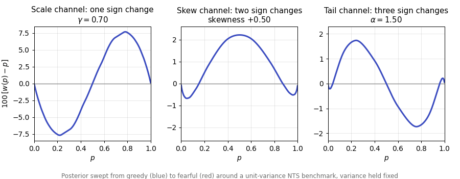

# Probability-Weighting Functions for Normal Tempered-Stable Laws

Code and data that reproduce every figure, table and number in

> Akash Deep, Bhathiya Divelgama, A. Alexandre Trindade, W. Brent Lindquist, Svetlozar T. Rachev, Frank J. Fabozzi.
> **Probability-Weighting Functions for Normal Tempered-Stable Laws: Orthogonal Channels and Information-Theoretic Indices.** Working paper, 2026.

One command regenerates the paper's 14 figures and 4 tables in about 30 seconds:

```bash
pip install -r requirements.txt
python src/run_all.py
```



*The paper's central result.* As beliefs about returns move from greedy to fearful along one channel at a time, with the variance held fixed, the deviation $w(p) - p$ changes sign once (scale), twice (skewness) or three times (tail thickness). The number of crossings identifies which feature of the return distribution a weighting function is responding to. (`python src/make_animation.py` regenerates the animation.)

## What the paper does

A probability-weighting function (PWF) turns objective probabilities into decision weights. Instead of assuming a parametric shape, the paper derives the PWF from a change in beliefs about returns. With a *prior* return distribution and a *posterior* one,

$$w(p) = F_{\text{post}}\big(Q_{\text{prior}}(p)\big), \qquad p \in [0,1],$$

where $Q_{\text{prior}}$ is the prior quantile function and $F_{\text{post}}$ the posterior CDF. If the two distributions coincide, $w(p) = p$.

Both distributions are **normal tempered-stable (NTS)** in the parameterization of Kim, Rachev, Bianchi and Fabozzi (2010), which is what the vendored `temStaPy` library implements:

$$X = \mu + \beta (T-1) + \gamma \sqrt{T} Z,$$

where $T$ is a tempered-stable subordinator with $\mathbb{E}[T] = 1$ and $\mathrm{Var}(T) = (2-\alpha)/(2\theta)$, and $Z$ is standard normal, independent of $T$.

The parameter vector is always `[alpha, theta, beta, gamma, mu]`: tail index, tempering, asymmetry, scale, location. The posterior differs from the prior along one of three **channels**, each with the variance held fixed:

| Channel | What changes | Fearful | Greedy |
|---|---|---|---|
| Scale | $\gamma$ | $\times 1.4$ | $\times 0.7$ |
| Skew | $\beta$ (with $\gamma$ reset to keep the variance) | skewness $-0.5$ | skewness $+0.5$ |
| Tail | $\alpha$ | $-0.3$ | $+0.3$ |

Each PWF is summarised by three indices: the Fisher-normalised logit shift $G_{\text{FI}}(p)$, the signed Jensen–Shannon divergence $S_{\text{JS}}(p)$ and the log-odds elasticity $E(p)$. Section 4 of the paper applies the channels to a stylized benchmark $(\alpha,\theta,\beta,\gamma,\mu) = (1.2, 0.4, 0, 1, 0)$, which has unit variance and excess kurtosis 3; Section 5 applies them around NTS parameters fitted to SPY daily log-returns, 2015–2025.

## Paper figures and tables → scripts

| Paper | Script (`src/`) | Output (`outputs/figures/` or `outputs/tables/`) |
|---|---|---|
| Figs 1–3 | `fig01_03_distributions.py` | `fig01_densities`, `fig02_cdfs`, `fig03_quantiles` |
| Figs 4–6 | `fig04_06_scale.py` | `fig04_scale_pwf`, `fig05_scale_gamma`, `fig06_scale_gfi` |
| Fig 7 | `fig07_skew.py` | `fig07_skew_deviation` |
| Figs 8–9 | `fig08_09_tail.py` | `fig08_tail_pwf`, `fig09_tail_indices` |
| Figs 10–14, Tables 2–4 | `fig10_14_empirical.py` | `fig10_spy_fit` … `fig14_spy_indices`; `table_*.csv`, `table_aggregate_indices.tex` |
| Table 1 and every number in the text | `summary_numbers.py` | `outputs/summary_numbers.json` |

Each figure is written as `.pdf` (used in the manuscript) and `.png`. Every script can be run on its own from any working directory. The manuscript's `\includegraphics` paths use the file names above, so updating the paper's figures is a copy of `outputs/figures/*.pdf` into the manuscript's `figures/` folder.

## Repository layout

```
src/
  nts_utils.py              the model: closed-form moments, channel construction,
                            PWF and its derivative, the three indices, aggregates
  paper_style.py            matplotlib style, colours and output paths shared by all figures
  fig01_03_distributions.py
  fig04_06_scale.py         one script per group of paper figures (table above)
  fig07_skew.py
  fig08_09_tail.py
  fig10_14_empirical.py
  summary_numbers.py        recomputes every number quoted in the text
  run_all.py                runs everything
lib/temStaPy_v0.5/          vendored NTS library (density, CDF, quantile, fitting)
data/spy_prices.csv         SPY adjusted close and daily log-return, 2015-01-02 to 2025-12-03
outputs/                    generated figures, tables and summary_numbers.json (git-ignored)
```

`data/rates_3m.csv` and `data/spy_dividend_yield.csv` are not used by the paper and are kept for a planned risk-neutral extension.

### Conventions worth knowing

- **Colours and line styles** are fixed in `paper_style.py`: benchmark black solid, fearful red dashed, greedy blue dash-dotted. Every figure uses them.
- **Variance matching** uses the closed-form variance $\gamma^2 + \beta^2 (2-\alpha)/(2\theta)$ in `nts_utils.nts_moments`, which agrees with `temStaPy.moments_NTS` to machine precision. `channel_specs(benchmark)` builds all three channels around any benchmark.
- **The PWF derivative** is computed exactly as the density ratio $f_{\text{post}}(Q_{\text{prior}}(p)) / f_{\text{prior}}(Q_{\text{prior}}(p))$ rather than by finite differences, so the elasticity index is smooth.
- **Probability grid**: $p_i = i/2001$, $i = 1,\dots,2000$. Integrated indices use the trapezoidal rule on this grid.
- **Estimation** (`fig10_14_empirical.py`) uses `temStaPy.fitnts`: location and scale from the sample mean and standard deviation, shape parameters by least squares between the NTS CDF and a kernel-smoothed empirical CDF. This is a minimum-distance estimator, not maximum likelihood; the paper says so.

### Changing the experiment

The stylized benchmark is `STYLIZED_BENCHMARK` in `nts_utils.py`; the channel sizes are the keyword arguments of `channel_specs` (`scale_factors`, `skew_shift`, `tail_shift`). Change them there and rerun `run_all.py`; `summary_numbers.json` then lists every number that needs updating in the text.

## Dependencies

Python 3.10 or later with `numpy >= 2.0`, `scipy`, `matplotlib`, `pandas` and `statsmodels` (see `requirements.txt`). Tested with numpy 2.5, scipy 1.18, pandas 3.0 and with the versions pinned in a fresh virtual environment.

`temStaPy` is vendored under `lib/` so that results do not depend on a particular release. The upstream project is [temStaPy](https://github.com/jay-gne/temStaPy); its own licence applies to `lib/temStaPy_v0.5/`. Two small compatibility edits were made to the vendored copy (`scipy.stats.kde` → `scipy.stats` imports).

## Citation

```bibtex
@unpublished{deep2026pwf,
  title  = {Probability-Weighting Functions for Normal Tempered-Stable Laws:
            Orthogonal Channels and Information-Theoretic Indices},
  author = {Deep, Akash and Divelgama, Bhathiya and Trindade, A. Alexandre and
            Lindquist, W. Brent and Rachev, Svetlozar T. and Fabozzi, Frank J.},
  note   = {Working paper},
  year   = {2026}
}
```

## Licence

The code in `src/` is released under the MIT licence (see [LICENSE](LICENSE)).

## Contact

Akash Deep, Department of Mathematics and Statistics, Texas Tech University: akash.deep@ttu.edu
